<div align="center">



<p><b>📊 Admin Dashboard</b></p>

<p>
  
  
  
  
  
  
</p>

</div>

## 📖 Overview

An admin dashboard for the **Consultie** consultation platform. It gives admins tools to monitor platform activity, manage users and bookings, handle payments and withdrawals, and moderate content.

## ✨ Key Features

### 📈 Insights

- Dashboard metrics & analytics reporting
- Earnings and transaction tracking

### 🗂️ Management

- Accounts & booking details
- Categories and subscription plans
- Withdrawal management
- Payments & transactions

### 🛡️ Moderation

- Content moderation & reported content review
- Complaints / feedback handling

### ⚙️ Settings

- General settings, profile & notifications
- About / Privacy / Terms editors
- Secure auth — login, OTP, password recovery

## 🛠️ Tech Stack

| Category | Technology |
|---|---|
| **Framework** | Next.js 16 (App Router) |
| **Language** | TypeScript |
| **UI** | Ant Design · Tailwind CSS |
| **State & API** | Redux Toolkit · RTK Query · Redux Persist |
| **Forms** | React Hook Form · Zod |
| **Charts** | Recharts |

## 🚀 Getting Started

### Prerequisites

- Node.js 18+ and npm

### Installation

```bash
git clone https://github.com/moazzembhuiyan/consult-app-dashboard.git
cd consult-app-dashboard
npm install
```

### Environment Variables

Create a `.env.local` file in the project root:

```env
NEXT_PUBLIC_BASE_URL=
```

| Variable | Description |
|---|---|
| `NEXT_PUBLIC_BASE_URL` | Backend API base URL |

### Run

```bash
npm run dev
# open http://localhost:3000
```

## 📜 Available Scripts

| Command | Description |
|---|---|
| `npm run dev` | Start the development server |
| `npm run build` | Create a production build |
| `npm run start` | Run the production build |
| `npm run lint` | Run ESLint |
| `npm run typecheck` | Run TypeScript type checking |

## 📁 Project Structure

```text
src/
├── app/
│   ├── (Auth)/          # Login, forgot password, OTP, set new password
│   └── admin/           # Protected admin pages
├── components/          # Reusable UI components
├── redux/               # Store, API slices (RTK Query) & state
├── schema/              # Zod validation schemas
├── theme/               # Ant Design theme config
├── lib/ · utils/        # Helpers & utilities
└── middleware.ts       # Route protection
```

## 📝 More Documentation

Detailed developer notes are available in [`docs/NOTES.md`](docs/NOTES.md).

---

<div align="center">

### 👨‍💻 Developed by [Moazzem Hossen Bhuiyan](https://github.com/moazzembhuiyan)

<sub>Mobile App Developer (React Native) • Web Developer</sub>

<p>
  <a href="https://github.com/moazzembhuiyan"></a>
  <a href="https://www.linkedin.com/in/moazzem-hossen-bhuiyan-325432331/"></a>
  <a href="mailto:moazzembhuiyan394@gmail.com"></a>
</p>

<sub>⭐ If you like this project, consider giving it a star!</sub>

</div>
